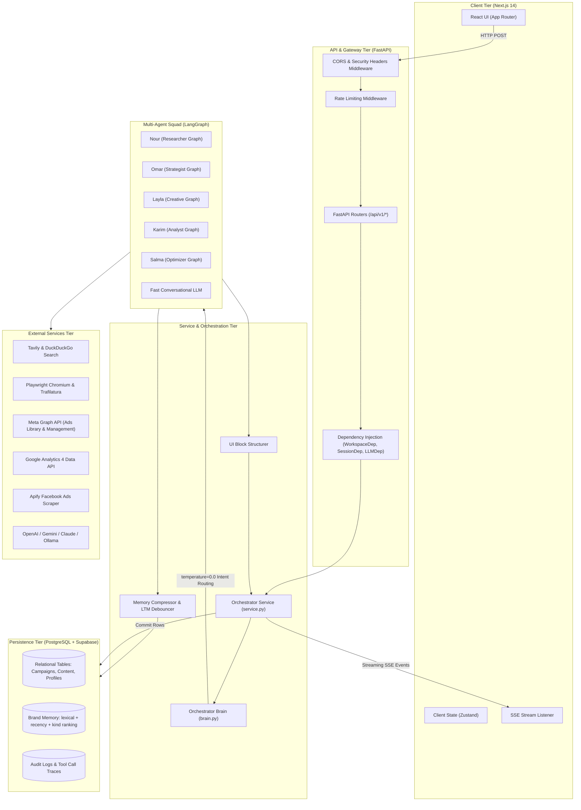

# System Architecture & Engineering Playbook

> **Audience:** Senior backend engineers, DevOps, AI platform engineers, and contributors maintaining and scaling SAHM Marketing OS.
> **Purpose:** The complete technical reference: system design, database schemas, API specifications, security protocols, development playbooks, and troubleshooting runbooks.
> **Start elsewhere if you can:** [`../README.md`](../README.md) is the one-page explanation of what the product does and how a request flows. This document is the reference you come back to.

### Two things named "orchestrator"

- `app/core/orchestrator/` — the **service** layer: conversations, persistence,
  SSE plumbing, background tasks. It does not choose agents.
- `app/ai/agents/orchestrator/` — the **brain**: `orchestrate()`, the routing
  prompt, the specialist graph wiring, the presentation layer.

The split is historical: the service layer predates the LangGraph migration and
kept its name. Read `service.py` for *when* things happen and `brain.py` for
*which agent* handles a turn.

---

## 1. High-Level Architecture & End-to-End Data Flow

SAHM is built as a cloud-native, asynchronous service oriented around multi-agent collaboration, streaming Server-Sent Events (SSE), and workspace-isolated, lifecycle-managed memory:



---

## 2. Full Database Schema & Entity-Relationship Model

The PostgreSQL database is organized into 5 logical clusters across 23 tables in `app/db/models.py`:

```
+----------------------------------------------------------------------------------------------------+
|                                  DATABASE ENTITY CLUSTERS                                          |
+----------------------------------------------------------------------------------------------------+
|                                                                                                    |
|  [Cluster 1: Multi-Tenancy & Identity]                                                             |
|  • businesses              --> Core tenant identity, budget, currency, industry, language          |
|  • brand_profiles          --> 1:1 with business: brand voice, visual style, target audience       |
|  • users / memberships     --> Accounts, and user-to-workspace RBAC (owner, member, viewer)        |
|  • profiles                --> Maps Supabase Auth UUID to business_id, role, user_context_summary  |
|  • sessions                --> Refresh/session records for the auth flow                           |
|                                                                                                    |
|  [Cluster 2: Memory & Chat Conversations]                                                          |
|  • conversations           --> Chat session metadata, sticky context (incl. UI language), summary  |
|  • messages                --> Individual turns: raw content + blocks (JSON UI Blocks)             |
|  • brand_memory_items      --> 13 memory kinds: text (~100 tokens), lifecycle columns, metadata    |
|  • saved_audiences         --> Reusable audience definitions per workspace                        |
|                                                                                                    |
|  [Cluster 3: Marketing Operations & Publishing]                                                    |
|  • campaigns               --> Marketing campaigns: name, objective, channel, budget, flight dates|
|  • content_items           --> Content calendar posts: date, time, channel, format, hook, caption  |
|  • creatives               --> Creative assets: image/video URL, aspect ratio, prompt, StyleSpec   |
|                                                                                                    |
|  [Cluster 4: Analytics, Insights & Safe Approvals]                                                 |
|  • insights                --> Automated findings: kind, severity (info/warning/critical), metrics |
|  • recommendations         --> Proposed changes: diff payload, estimated impact, approval status   |
|                                                                                                    |
|  [Cluster 5: Security, Governance & Auditing]                                                      |
|  • audit_logs              --> Immutable append-only log of every approval, change, and actor     |
|  • tool_settings           --> Per-workspace connector configuration (encrypted API keys)          |
|  • llm_provider_settings   --> Workspace-level fast/strong LLM provider routing & credentials      |
|  • usage_records           --> Token accounting rows (tokens_in, tokens_out, model, task_id)       |
|  • integrations            --> Encrypted OAuth grants (Meta access tokens, expiry, scopes)         |
|  • agent_tasks             --> Background long-running tasks: status, progress, steps, error       |
|  • agent_tool_calls        --> Audit trace of every tool execution: input, output, duration_ms    |
|                                                                                                    |
+----------------------------------------------------------------------------------------------------+
```

### Table Definitions & Key Column Constraints

#### 1. `businesses` Table
- `id` (VARCHAR(64), PK): Unique business ID (e.g., `biz_abc123`).
- `workspace_id` (VARCHAR(64), indexed): Workspace namespace for multi-business tenancy.
- `name` (VARCHAR(200)): Commercial brand name.
- `industry` (VARCHAR(120)): Industry vertical (e.g., "Specialty Coffee", "Men's Apparel").
- `monthly_budget` (FLOAT): Target monthly marketing budget.
- `currency` (VARCHAR(8)): Operational currency (`EGP`, `USD`, `SAR`, `AED`).
- `daily_token_budget` (INTEGER, nullable): Per-workspace token spend cap override.

#### 2. `brand_memory_items` Table
- `id` (VARCHAR(64), PK): Unique memory ID (e.g., `mem_res_510a4c514cf0`).
- `business_id` (VARCHAR(64), FK ➔ `businesses.id`, ON DELETE CASCADE): Tenant scoping.
- `kind` (VARCHAR(40), indexed): one of the 13 kinds in `app/core/memory/kinds.py` (`brand_identity`, `voice_example`, `visual_style`, `offer`, `audience`, `strategy_blueprint`, `competitor_note`, `market_research`, `market_gaps`, `website_analysis`, `reference_analysis`, `chat_attachment`, `learning`). The registry — not the database — owns each kind's TTL, importance and token cap.
- `text` (TEXT): Compact distilled facts strictly between 80 and 120 words (~100 tokens).
- `dedupe_digest`: SHA-256 of the normalised (kind, workspace, campaign, text) -- no vector column.
- `expires_at` / `archived_at` / `importance` / `pinned`: the lifecycle columns that replaced reindexing.
- `metadata` (JSONB): Full 380-word structured report under `full_report`, citations, and timestamp.

#### 3. `content_items` Table
- `id` (VARCHAR(64), PK): Content ID (e.g., `cnt_abc123`).
- `business_id` (VARCHAR(64), FK ➔ `businesses.id`, ON DELETE CASCADE): Tenant scoping.
- `date` (DATE/DateString): Target post date in `YYYY-MM-DD` format.
- `time` (VARCHAR(5)): Target time in `HH:MM` format (e.g., `18:00`).
- `channel` (VARCHAR(32)): `instagram`, `facebook`, `tiktok`, `email`, `blog`.
- `format` (VARCHAR(32)): `post`, `reel`, `story`, `ad`, `article`, `email`.
- `title` (VARCHAR(255)): Concept title.
- `hook` (TEXT, nullable): Opening 3-second hook.
- `caption` (TEXT, nullable): Full post copy with call to action.
- `hashtags` (JSONB): List of hashtag strings.
- `status` (VARCHAR(32)): `scheduled`, `draft`, `published`.
- `pillar` (VARCHAR(100)): Content pillar name.

#### 4. `recommendations` Table
- `id` (VARCHAR(64), PK): Recommendation ID.
- `workspace_id` (VARCHAR(64), FK ➔ `businesses.id`): Direct tenant ownership.
- `campaign_id` (VARCHAR(64), FK ➔ `campaigns.id`, nullable): Associated campaign.
- `action_type` (VARCHAR(60)): Change type (e.g., `reallocate_budget`, `pause_adset`).
- `title` (VARCHAR(400)): Concise action title.
- `rationale` (TEXT): Data-backed explanation for the proposed change.
- `diff` (JSONB): Exact before/after JSON delta to display to the user.
- `status` (VARCHAR(20)): `pending`, `approved`, `rejected`, `applied`.
- `requires_approval` (BOOLEAN, default True): Human approval gate.
- `approved_by` (VARCHAR(120)): User email/ID who authorized execution.

---

## 3. Complete REST API Specification

All endpoints are hosted under `/api/v1/` and enforce CORS, rate limiting, and request IDs:

### Core Endpoints Table

| Category | Method | Path | Request Body / Query | Response Model / Payload |
| :--- | :--- | :--- | :--- | :--- |
| **Assistant** | `POST` | `/assistant/message` | `AssistantMessageRequest` (message, conversation_id, context) | `AssistantMessageResponse` (blocks, message, task_id) |
| **Assistant** | `POST` | `/assistant/message/stream` | `AssistantMessageRequest` | `StreamingResponse` (Server-Sent Events) |
| **Assistant** | `GET` | `/assistant/conversations` | — | `list[ConversationSummary]` |
| **Assistant** | `GET` | `/assistant/conversations/{id}` | — | `ConversationDetail` (messages with blocks) |
| **Research** | `POST` | `/research/run` | `RunResearchRequest` (tool, query) | `ResearchItemOut` (title, summary, details, citations) |
| **Research** | `GET` | `/research/items` | — | `list[ResearchItemOut]` |
| **Content** | `GET` | `/content` | `month=YYYY-MM`, `campaignId=...` | `list[ContentItemOut]` |
| **Content** | `POST` | `/content/generate` | `GenerateContentCalendarRequest` (month, posts_per_week, channels) | `list[ContentItemOut]` |
| **Content** | `PATCH` | `/content/{id}` | `UpdateContentItemRequest` (date, time, status, caption) | `ContentItemOut` |
| **Content** | `DELETE`| `/content/{id}` | — | `{"status": "deleted"}` |
| **Brand Identity**| `GET` | `/business/brand-identity` | — | `BrandIdentityResponse` (colors, essence, audience, SWOT, offers, competitors) |
| **Brand Identity**| `POST` | `/business/brand-identity/sync` | `{}` | `BrandIdentityResponse` (synthesizes profile from all chats & memory) |
| **Brand Identity**| `PATCH` | `/business/brand-identity` | `BrandIdentityUpdateRequest` | `BrandIdentityResponse` (updates colors, voice, audience, SWOT) |
| **Campaigns**| `POST` | `/campaigns/generate-strategy` | `GenerateStrategyRequest` (objective, dailyBudget, brief) | `CampaignStrategy` (phases, kpis, channels, messaging) |
| **Campaigns**| `POST` | `/campaigns` | `CampaignCreateRequest` (name, objective, channel, budget) | `Campaign` |
| **Campaigns**| `GET` | `/campaigns` | — | `CampaignListResponse` |
| **Campaigns**| `GET` | `/campaigns/{id}` | — | `CampaignDetailResponse` (creatives & recommendations) |
| **Creatives**| `POST` | `/creatives/analyze-reference` | `AnalyzeReferenceRequest` (image_url, focus) | `ReferenceAnalysis` (StyleSpec) |
| **Creatives**| `POST` | `/creatives/generate` | `GenerateCreativeRequest` (prompt, aspect_ratio, style_spec) | `GenerateCreativeResponse` |
| **Approvals**| `GET` | `/recommendations` | `status=pending` | `list[Recommendation]` |
| **Approvals**| `POST` | `/recommendations/{id}/approve`| `ApproveRecommendationRequest` (confirm=true, note) | `ApproveRecommendationResponse` |
| **Approvals**| `POST` | `/recommendations/{id}/reject` | `RejectRecommendationRequest` (reason) | `Recommendation` |
| **Insights** | `GET` | `/campaigns/{id}/insights` | `date_start`, `date_end` | `CampaignInsightsResponse` |
| **Settings** | `GET` | `/settings/connectors` | — | `ToolSettingsResponse` |
| **Settings** | `PATCH`| `/settings/connectors` | `UpdateToolSettingsRequest` | `ToolSettingsResponse` |
| **Settings** | `GET` | `/settings/llm` | — | `LlmProviderSettingsOut` |
| **Settings** | `PATCH`| `/settings/llm` | `UpdateLlmProviderSettingsIn` | `LlmProviderSettingsOut` |
| **Memory** | `GET` | `/memory/items` | `kind=...`, `q=...`, `includeArchived` | `list[MemoryItemOut]` (ranked, each with `score` and `reason`) |
| **Memory** | `POST` | `/memory/items` | `MemoryItemCreate` (kind, text, campaignId, importance, pinned) | `MemoryItemOut` |
| **Memory** | `PATCH`/`DELETE` | `/memory/items/{id}` | `MemoryItemUpdate` | `MemoryItemOut` |
| **Memory** | `POST` | `/memory/items/{id}/archive` | — | `MemoryItemOut` (soft delete, keeps the audit trail) |
| **Memory** | `POST` | `/memory/prune` | `{"dryRun": true, "kind": null}` | `PruneReport` (expired + over-cap rows per kind) |
| **Tasks** | `POST` | `/tasks` | `CreateTaskRequest` | `AgentTaskOut` |
| **Tasks** | `GET` | `/tasks/{id}` / `/tasks/{id}/stream` | — | task state / SSE progress |
| **Personas** | `GET`/`PATCH` | `/personas`, `/personas/{id}` | `PersonaUpdate` | per-workspace persona overrides |
| **Tools** | `GET` | `/tools`, `/tools/connectors` | — | tool catalog and connector status |
| **Tools** | `POST` | `/tools/{name}/invoke` | tool input | tool output (read-only tools only) |
| **Governance**| `GET` | `/usage` | — | `UsageSummaryResponse` |
| **Governance**| `GET` | `/audit` | — | `list[AuditLogOut]` |

---

## 4. Security Protocols & Cryptographic Safeguards

### 1. TokenCipher: Fernet Symmetric Encryption at Rest
All third-party credentials—Meta Graph access tokens, Google service accounts, Apify keys, search keys—are encrypted before writing to PostgreSQL:
- **Algorithm:** AES-128 in CBC mode with HMAC-SHA256 authenticated encryption via `cryptography.fernet.Fernet`.
- **Key Derivation:** Master key provided via `TOKEN_ENCRYPTION_KEY` in environment variables.
- **Startup Guard:** In production environments (`ENVIRONMENT=prod`), the backend refuses to boot if the default dev encryption key is detected (`verify_runtime_security()`).
- **Write-Only Over HTTP:** Encrypted tokens are strictly write-only; plaintext keys are never returned in JSON responses or written to application log files.

### 2. SSRF Protection & URL Sanitization
When tools like `analyze_website` or `analyze_reference` accept external URLs:
- Schemes are strictly validated against `http://` and `https://`.
- Internal network IP addresses (`127.0.0.1`, `10.0.0.0/8`, `192.168.0.0/16`, `169.254.169.254` AWS metadata) are rejected to prevent Server-Side Request Forgery.

### 3. Tenant Isolation & ID Enumeration Defense
- Every query enforces `business_id == ws.business_id`.
- If an authenticated user queries an entity belonging to another workspace, the backend returns **404 Not Found** (never 403 Forbidden). Returning 403 would reveal that the resource ID exists.

---

## 5. Engineering Playbooks: How to Extend SAHM

### Playbook A: Adding a Workspace Tool in 5 Steps

There are two tool families and they are not interchangeable:

| Family | Location | Shape | Used by |
| :--- | :--- | :--- | :--- |
| **Workspace tools** | `app/core/tools/` | `Tool` object (input model, output model, async handler) | The generic runtime, the tool API, MCP export |
| **AI-native tools** | `app/ai/tools/` | LangChain `@tool` functions | The specialist LangGraphs |

To add a workspace tool:

1. **Input + output models:** Pydantic models in `app/schemas/tools.py` (or next
   to the handler). Every field gets a description — the model reads it.
2. **Handler:** `async def _handle(request, ctx: ToolContext) -> Output`. All the
   context a handler may use arrives in `ctx` (db, llm, workspace, campaign);
   handlers never read globals, which is what makes them unit-testable.
3. **Declare the tool:**
   ```python
   MY_TOOL = Tool(
       name="my_tool",
       description="What it does, and when NOT to use it.",
       input_model=MyInput,
       output_model=MyOutput,
       side_effect=ToolSideEffect.READ,   # EXTERNAL_WRITE is rejected by the registry
       handler=_handle_my_tool,
   )
   ```
4. **Register:** add it to the relevant list in `app/core/tools/registry.py`
   (`RESEARCH_TOOLS`, `MEMORY_TOOLS`, `META_READ_TOOLS`, `MEDIA_TOOLS`,
   `RECORDS_TOOLS`) and add the name to the personas allowed to use it.
5. **Test:** a test in `tests/` that calls the handler with a fake `ToolContext`
   and asserts both the success path and the "source unavailable" path. A tool
   that cannot reach its source must return `status="unavailable"` with a reason,
   never invented data.

### Playbook B: Adding a New Fast/Strong LLM Provider
1. Add the provider's OpenAI-compatible base URL to `OPENAI_COMPATIBLE_URLS` in `app/core/llm/router.py`.
2. In `app/config.py`, add the provider string to allowed enum literals in `Settings`.
3. In `app/core/llm/router.py`, map the provider API key to the client constructor in `build_client()`.
4. Update `SAHM-AI-backend/.env` with the new provider key and set `LLM_PROVIDER_FAST` or `LLM_PROVIDER_STRONG`.

### Playbook C: Running Database Schema Migrations
1. Modify or add models in `app/db/models.py`.
2. Generate an Alembic migration script:
   ```powershell
   uv run alembic revision --autogenerate -m "add_new_feature_table"
   ```
3. Review the generated file in `app/db/migrations/versions/`.
4. Apply the migration:
   ```powershell
   uv run alembic upgrade head
   ```

---

## 6. Troubleshooting & Operational Runbook

Symptoms first, because a reviewer usually arrives with one of these:

| Symptom | Likely cause | Where to look |
| :--- | :--- | :--- |
| Answer is in the wrong language | client not sending `language`, or a stale conversation carrying an old choice | `app/core/i18n.py`, `conversation.context["language"]` — see `LANGUAGE_POLICY.md` |
| Agent "forgot" its role / generic answer | a prepended system message pushed the role prompt out of position | `app/ai/agents/*/graph.py::call_model` |
| Empty or thin brand context | memory disabled, or all rows expired | `MEMORY_ENABLED`, `POST /memory/prune` dry run |
| `ProviderNotConfigured` | missing key for the selected provider | `app/ai/providers/llm/*` |
| 409/404 on a resource that exists | workspace mismatch — IDs are tenant-scoped by design | `app/api/deps.py` |


### Issue 1: `SSLEOFError` / `MaxRetryError` with Remote Ollama / ngrok
- **Root Cause:** The Google Colab instance restarted or ngrok regenerated a new public URL.
- **Solution:** Check your running Colab cell, copy the new ngrok URL (e.g., `https://xyz.ngrok-free.dev`), update `OLLAMA_BASE_URL` in `SAHM-AI-backend/.env`, and restart the FastAPI server.

### Issue 2: Pydantic Enum Serialization Failure in SSE Stream
- **Root Cause:** Streaming endpoints using Starlette `StreamingResponse` fail if raw Pydantic Enum objects are serialized with default `json.dumps`.
- **Solution:** Always serialize blocks using `.model_dump(mode="json", by_alias=True)`.

### Issue 3: Rate Limits on Fast LLM (HTTP 429)
- **Root Cause:** Free-tier Gemini or Groq API keys hit per-minute token limits during heavy research runs.
- **Solution:** The UI Structurer in `brain.py` contains an automatic fallback to `TextBlock(text=final_msg)` so users still receive their full response even if block formatting is temporarily throttled.
