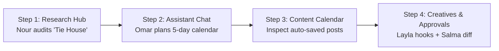

# 🎤 SAHM Marketing OS — Presentation, Pitch Deck & Live Demo Playbook

> **Purpose:** A ready-to-use guide for delivering high-impact presentations, investor pitch decks, academic/graduation project defenses, and flawless live software demonstrations of SAHM AI.  
> **How to Use:** Copy slide text directly into PowerPoint/Google Slides, use the speaking scripts for rehearsals, and follow the step-by-step live demo prompts during presentations.

---

## 1. Executive Pitch: The 30-Second & 2-Minute Hooks

### The 30-Second Elevator Pitch
> *"Every small business owner knows they need marketing, but hiring a full marketing department—a researcher, copywriter, designer, media buyer, and strategist—costs over \$5,000 to \$10,000 every month. Generic AI tools like ChatGPT don't solve this because they have zero memory of the brand, hallucinate facts, and write robotic Arabic.  
> **SAHM AI (سهم)** is an autonomous Marketing Operating System that gives business owners a dedicated squad of 5 specialized AI marketing agents. From live competitor research and real-time review extraction to 90-day strategy blueprints, automated content calendar scheduling, and safe Meta ad optimization, SAHM does the work of an entire agency in minutes for a fraction of the cost."*

### The 2-Minute Executive Summary
> *"Traditional digital marketing in Egypt and the MENA region is fundamentally broken for SMBs and e-commerce brands. First, high headcount costs make professional marketing inaccessible to 90% of businesses. Second, tools are completely fragmented—analytics platforms don't talk to copywriters, and copywriters don't remember customer reviews. Third, existing AI tools fail miserably at regional nuances—they don't understand Egyptian consumer psychology, local price anchors in EGP, or dialect-native ad hooks.  
>  
> We built **SAHM AI** to replace this fragmented mess with an autonomous 'Marketing Department in a Box'. When a user logs in, they interact with a specialized squad coordinated by an Orchestrator: Nour conducts live web and competitor research with verified sources; Omar turns that intelligence into 90-day roadmaps and automated content calendars; Layla drafts high-converting ad copy and 3-second video hooks; Karim connects directly to Google Analytics 4 to track real traffic and conversions; and Salma monitors campaign spend to propose safe, human-approved budget optimizations.  
>  
> Behind the scenes, SAHM is powered by FastAPI, LangGraph state machines, Next.js 14, and our proprietary **Zero-Token-Bloat Brand Memory Engine** with dual-layer storage and Arabic-aware token compression. SAHM doesn't just generate text—it runs the entire marketing lifecycle with enterprise governance and human-in-the-loop safety."*

---

## 2. 10-Slide Pitch Deck Presentation Structure

```
+----------------------------------------------------------------------------------------------------+
|                                    10-SLIDE PITCH DECK BLUEPRINT                                    |
+----------------------------------------------------------------------------------------------------+
|  Slide 1: Title & Vision       │ Slide 6: System Architecture & Tech Stack                         |
|  Slide 2: The Problem          │ Slide 7: Proprietary Innovations & Memory Engine                  |
|  Slide 3: The Solution (SAHM)  │ Slide 8: Live Product Demonstration Walkthrough                   |
|  Slide 4: Meet the AI Squad    │ Slide 9: Commercial Model & Market Opportunity                    |
|  Slide 5: Core Product Engine  │ Slide 10: Future Roadmap & Closing Vision                         |
+----------------------------------------------------------------------------------------------------+
```

### Slide 1: Title & Vision
- **Header:** SAHM AI (سهم) — The Autonomous Marketing Operating System
- **Subheader:** An Entire Multi-Agent Marketing Department in a Box for SMBs & E-Commerce
- **Key Visual:** Screenshot of SAHM Dashboard showing the active marketing squad and live metrics.
- **Presenter Script:** *"Good morning. Today we are introducing SAHM AI, an autonomous multi-agent operating system designed to democratize high-performance marketing for businesses across Egypt and the MENA region."*

### Slide 2: The Problem
- **Header:** The Three Crushing Barriers in Modern Marketing
- **Three Columns:**
  1. **Prohibitive Payroll:** Hiring 5 specialized marketers costs \$4,000–\$10,000/month.
  2. **Context Fragmentation:** Google Analytics, Meta Ads, and design tools live in silos with zero shared memory.
  3. **The Regional Execution Gap:** Western AI tools write robotic Modern Standard Arabic, ignore EGP currency realities, and miss Egyptian consumer psychology.
- **Presenter Script:** *"Today, 85% of small businesses in our region fail at paid ads or abandon marketing altogether. They cannot afford an agency, and tools like ChatGPT produce generic, ungrounded text that doesn't sell."*

### Slide 3: The Solution
- **Header:** SAHM AI — An Autonomous Marketing Department in a Box
- **Bullet Points:**
  - **Collaborative AI Squad:** Specialized agents working together under an Orchestrator.
  - **Unified Brand Memory:** Learns the brand once and remembers every competitor, review, and goal.
  - **Actionable Execution:** From live web research to one-click content calendars and governed ad approvals.
- **Presenter Script:** *"SAHM replaces fragmented tools with a team of AI marketing specialists that collaborate seamlessly, remember the brand's unique history, and execute real tasks in seconds."*

### Slide 4: Meet The AI Squad
- **Header:** 5 Specialized AI Marketers Under One Orchestrator
- **Visual Grid:**
  - 🔍 **Nour (نور) — Lead Researcher:** Ground-truth competitor audits, web scraping, Google Maps reviews.
  - 🎯 **Omar (عمر) — Chief Strategist:** Brand positioning, 90-day roadmaps, multi-channel budget allocations.
  - ✍️ **Layla (ليلى) — Creative Director:** 3-second visual hooks, dialect-native ad copy, video scripts.
  - 📊 **Karim (كريم) — Performance Analyst:** GA4 traffic metrics, conversion funnel analysis, ROAS reporting.
  - ⚙️ **Salma (سلمى) — Campaign Optimizer:** Spend reallocations, creative fatigue alerts, 2-phase human approvals.
- **Presenter Script:** *"Instead of a single generalist chatbot trying to do everything poorly, SAHM uses specialized LangGraph state machines. Each agent has its own guardrails, tools, and output schemas."*

### Slide 5: The Product Engine & Features
- **Header:** End-to-End Capabilities Across the Marketing Lifecycle
- **Feature Icons:**
  - **Research Hub:** 9 live tools with typo auto-correction and real web citations.
  - **Content Calendar:** Automated multi-day post generation saved directly to the database.
  - **Assistant Chat:** Token-by-token SSE streaming with interactive Generative UI blocks.
  - **Campaigns & Creatives:** Meta/TikTok campaign structures and reference style analysis.
  - **Safety First:** 2-phase human-in-the-loop approvals before touching ad accounts.
- **Presenter Script:** *"SAHM covers the complete growth loop: discovering what competitors are doing, formulating the campaign, writing the copy, scheduling the calendar, and optimizing spend safely."*

### Slide 6: Architecture & Technology Stack
- **Header:** Robust, Scalable & Enterprise-Grade Engineering
- **Architecture Diagram:** Next.js 14 (Frontend) ➔ FastAPI (API Layer) ➔ Central Memory Engine ➔ LangGraph Multi-Agent Squad ➔ External APIs (Meta, GA4, Apify, Tavily).
- **Core Technologies:** FastAPI, LangChain, LangGraph, PostgreSQL + pgvector (Supabase), Next.js 14 App Router, Tailwind CSS, Fernet encryption.
- **Presenter Script:** *"Our backend is built on FastAPI and LangGraph with PostgreSQL vector storage. It features full multi-tenant isolation, encrypted credential storage, and real-time Server-Sent Events streaming."*

### Slide 7: Proprietary Innovations & Memory Engine
- **Header:** Eliminating Token Bloat with Dual-Layer Memory
- **Key Innovations:**
  1. **Dual-Layer Storage:** Detailed 380-word reports for human eyes, distilled ~100-token facts for AI prompts (93% token reduction).
  2. **Arabic-Aware Token Compression:** Language-calibrated token estimation (~1.8 characters/token for Arabic vs 3.5 for Latin).
  3. **Plan vs Fact Isolation:** Prevents router contamination by keeping unconfirmed marketing plans out of general classification prompts.
  4. **Ground-Truth Entity Resolver:** Verifies businesses and auto-corrects typos before querying search engines.
- **Presenter Script:** *"Our biggest engineering breakthrough is our memory architecture. While naive AI systems crash or blow their budgets passing 15,000 tokens per message, SAHM maintains sub-1,000 token context windows without losing a single piece of business data."*

### Slide 8: Live Product Demonstration
- **Header:** Live Walkthrough: From Zero to Full Marketing Campaign in 3 Minutes
- **Demo Highlights:**
  - Running live competitor research on an Egyptian retail brand (e.g. Tie House).
  - Generating a 5-day multi-channel content calendar that auto-saves to the calendar database.
  - Generating direct-response ad copy and reviewing a budget optimization recommendation.
- **Presenter Script:** *"Let us now switch to the live application to see the agents in action."*

### Slide 9: Market Opportunity & Business Model
- **Header:** Commercial Potential in MENA & Monetization Strategy
- **Market Data:**
  - Over 4 million registered SMBs in Egypt and 10+ million in the MENA region.
  - \$3.2B regional digital ad spend growing at 18% YoY.
- **Revenue Model:**
  - **Starter Tier (\$49/mo):** Solopreneurs & single brands (Research + Assistant + Calendar).
  - **Growth Tier (\$149/mo):** Scaling e-commerce (GA4 + Meta integration + Image generation).
  - **Agency Multi-Tenant Tier (\$399/mo):** Unlimited client workspaces with RBAC governance.
- **Presenter Script:** *"Our business model is high-margin B2B SaaS. We provide an order-of-magnitude cost reduction: \$149/month replaces a \$5,000/month human agency retainer."*

### Slide 10: Roadmap & Future Vision
- **Header:** The Road Ahead: Fully Autonomous Social & CRM Execution
- **Roadmap Milestones:**
  - Q1 2027: Direct organic social auto-publishing to Instagram, Facebook, and TikTok.
  - Q2 2027: WhatsApp conversational CRM integration for automated sales lead qualification.
  - Q3 2027: Video asset generation engine with synthetic dialect-native voiceovers.
- **Presenter Script:** *"SAHM AI is building the operating system that will power the next generation of commerce in the Middle East. Thank you, and we welcome your questions."*

---

## 3. Step-by-Step Live Demo Script (Foolproof Flow)

Follow this 4-step demonstration flow during live presentations. These prompts have been battle-tested in the codebase.



### Step 1: Live Competitor Intelligence (Research Hub)
1. **Navigate to:** `/research`
2. **Action:** Click the **Competitor research** tool card.
3. **Input:** Type `"Tie House"` (or intentionally type a misspelling like `"Tiee Hose"` to demonstrate ground-truth typo auto-correction).
4. **Click:** "Run"
5. **What to Point Out on Screen:**
   - Notice the ground-truth verification notice correcting the name.
   - Point out the structured sections: *Market Share in Egypt*, *Advertising Angles*, *Vulnerabilities*.
   - Point out the **clickable live web sources** at the bottom proving that the agent did not hallucinate.
   - Explain that behind the scenes, a compact 100-token memory item was just saved to the brand database!

### Step 2: Strategic Content Planning (Assistant Chat)
1. **Navigate to:** `/assistant`
2. **Prompt (Arabic or English):**
   > *"عايز جدول محتوى للحملة الجاية لمدة 5 أيام وزعهم في الكالندر"*  
   > *(Or in English: "Create a 5-day content calendar for our upcoming campaign and schedule them in the calendar")*
3. **What to Point Out on Screen:**
   - Watch the Orchestrator status pill: Notice it automatically routes to **Omar** because of the intent to schedule posts.
   - Point out the real-time SSE streaming.
   - Show how the response renders as structured **Generative UI Blocks** with findings and clean formatting, rather than a raw JSON dump.

### Step 3: Verify Automated Calendar Persistence (Calendar Hub)
1. **Navigate to:** `/calendar`
2. **What to Point Out on Screen:**
   - Show that the 5 days of posts generated by Omar in the chat thread are **already populated in the calendar database!**
   - Click on an Instagram Reel card: Show the hook, caption, hashtags, and optimal posting time (`18:00`).
   - Explain: *"This is true multi-agent cohesion—the chat agent doesn't just talk, it executes and writes directly to our application database."*

### Step 4: Direct-Response Ad Copy & Safe Approvals (Creatives & Approvals)
1. **Return to:** `/assistant`
2. **Prompt:**
   > *"ليلى، اكتبيلي 3 أفكار إعلانات فيديو ريلز 15 ثانية بهوك قوي يجذب الشباب"*  
   > *(Or: "Layla, write 3 15-second Reels ad concepts with strong visual hooks targeting young professionals")*
3. **What to Point Out:**
   - Notice the Orchestrator instantly routes to **Layla**.
   - Show how the copy uses culturally relevant Egyptian hooks (status, urgency, fabric quality).
4. **Navigate to:** `/recommendations`
5. **What to Point Out:**
   - Show the two-phase approval card with estimated impact and before/after diff.
   - Click "Approve": Explain that only now does the backend execute changes on Meta and stamp the audit log.

---

## 4. Competitive Advantage Matrix

| Capability / Dimension | Traditional Agency | Generic ChatGPT / Claude | Western AI (Jasper/Copy.ai) | **SAHM AI (سهم)** |
| :--- | :--- | :--- | :--- | :--- |
| **Monthly Cost** | \$2,500 – \$10,000 | \$20 / user | \$49 – \$199 / user | **\$49 – \$149 / business** |
| **Turnaround Time** | 3 to 14 days | Instant | Instant | **10 to 30 seconds** |
| **Brand Memory** | Stored in human brains / docs | Lost every new chat | Shallow company bio | **4-tier vector memory + LTM** |
| **Egyptian & MENA Nuance** | Excellent (human) | Poor (Stiff MSA Arabic) | Poor (English-centric) | **Native bilingual (Egyptian dialect)** |
| **Live Web Evidence** | Manual search | Hallucinations likely | Static templates | **Tavily/DDG + Ground-truth verified** |
| **Actionable Execution** | Manual | Text only (no calendar/DB) | Text only | **Auto-persists to DB & Calendar** |
| **Human-in-the-Loop Safety** | Prone to human errors | Cannot touch ad accounts | Cannot touch ad accounts | **2-phase approval + audit logs** |

---

## 5. Q&A Preparation: The 10 Hardest Questions & Winning Answers

### Q1: "Why did you build a multi-agent system instead of one master prompt in ChatGPT?"
> **Answer:** *"A single monolithic prompt suffers from cognitive interference. When you ask a single prompt to research competitors, design visual creatives, allocate budgets, and verify facts all at once, accuracy collapses and hallucination rates surge. By decomposing marketing into specialized LangGraph state machines—Nour for research, Omar for strategy, Layla for copy, Karim for analytics—each agent operates within strict, specialized guardrails, resulting in 10x higher fidelity."*

### Q2: "How do you prevent the AI from hallucinating fake competitors or prices?"
> **Answer:** *"We built our Ground-Truth Entity Verification Engine (`verify_and_resolve_entity`). Before any research runs, the system checks whether the entity is recognized in the commercial market, auto-corrects typos, and rejects fake queries. Furthermore, every claim in our research reports requires a verified web source citation with canonical URLs extracted during the scraping pass."*

### Q3: "What prevents your database memory from blowing up LLM token limits?"
> **Answer:** *"Our Dual-Layer Storage Pattern. When research is conducted, we generate a 380-word report for human inspection in UI metadata, but our fast LLM immediately compresses it to an 80–120 word (~100 token) distilled fact in the `text` column. When agents query memory, they ingest only ~100 tokens per item instead of 1,500. Additionally, our session threshold compressor automatically summarizes older chat turns once a session reaches 1,500 tokens."*

### Q4: "How does SAHM handle Arabic dialect vs Modern Standard Arabic?"
> **Answer:** *"Traditional marketing tools write stiff, robotic Modern Standard Arabic (فصحى) which performs terribly in direct-response ads in Egypt. Our agent prompts (especially Layla and Omar) are specifically calibrated with Egyptian business Arabic, colloquial hooks, humor, and cultural pattern interrupts that mirror how real Egyptian consumers speak and buy."*

### Q5: "Is it safe to let an AI touch a business's real Meta ad budget?"
> **Answer:** *"Yes, because agents are architecturally forbidden from writing to Meta directly. The write tools (`apply_change`, `publish_campaign`) are physically excluded from the agent tool registry. An agent can only create a pending recommendation. Execution requires a human owner to inspect the before/after diff and click 'Approve'. Every action is permanently recorded in our immutable audit log."*

### Q6: "Can SAHM work with local open-source models like Ollama, or are you locked to OpenAI?"
> **Answer:** *"SAHM is 100% provider-agnostic. Our dual-tier LLM router supports OpenAI, Anthropic Claude, Google Gemini, Groq, DeepSeek, and local Ollama instances (including Qwen and Llama models via ngrok). Workspaces can even configure local models for fast summarization and cloud models for creative copywriting."*

### Q7: "How does the Content Calendar connect to what the agents do in chat?"
> **Answer:** *"When a user asks Omar in the assistant chat to plan a 5-day campaign across channels, Omar calls the `generate_content_calendar` tool. That tool generates structured post objects, and our Orchestrator automatically persists them into the `ContentItem` table in PostgreSQL. When the user opens `/calendar`, the posts are already scheduled in the UI."*

### Q8: "How does SAHM handle multi-tenancy and data isolation between competing brands?"
> **Answer:** *"Every database query strictly enforces `business_id == ws.business_id`. All vector similarity searches, memory retrievals, and campaign queries are partitioned by workspace ID. Attempting to query another tenant's entity returns a 404 Not Found rather than a 403 to prevent entity existence enumeration."*

### Q9: "How does Karim fetch real Google Analytics 4 metrics without asking the user for code?"
> **Answer:** *"We integrated the Google Analytics Data API v1 beta. Through server environment credentials or workspace connector settings, Karim queries GA4 properties over date ranges to retrieve real sessions, bounce rates, average duration, and conversion events, synthesizing them into executive summaries."*

### Q10: "What is your commercial rollout strategy?"
> **Answer:** *"We are targeting the 250,000+ active e-commerce brands and marketing agencies in Egypt and the GCC. By partnering with local Shopify/WooCommerce merchant communities, e-commerce accelerators, and regional digital agencies who can white-label SAHM for their clients, we offer an agency-grade marketing stack at a 90% cost reduction."*
