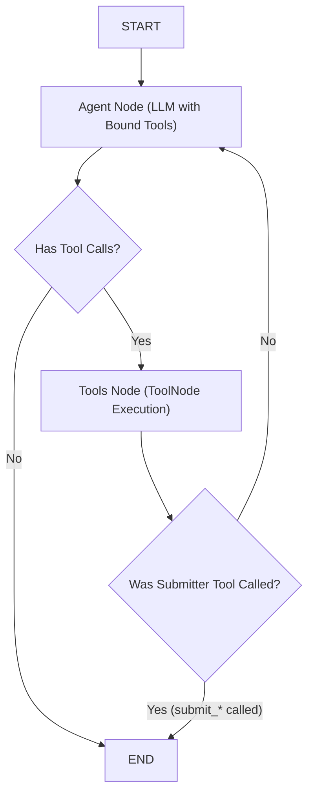

# 🛠️ SAHM Marketing OS — Tools & Agents Engineering Guide

> **Audience:** Developers, AI engineers, and technical contributors tasked with building, debugging, and improving **Tools** and **Agents** in SAHM AI.  
> **Purpose:** A complete, hands-on engineering manual and reference playbook. You can hand this document directly to an AI assistant (Claude, ChatGPT, Gemini) to collaborate on developing new tools, tuning prompts, or optimizing multi-agent execution.

---

## 1. Core Architecture: Tools & Agents in SAHM

In the SAHM Marketing Operating System:
- **Tools** are the sensory organs and operational levers of the system. They scrape landing pages, search live web indexes, pull Google Analytics metrics, scrape Google Maps reviews, inspect competitor Facebook ads, generate day-by-day content schedules, and persist marketing assets into PostgreSQL.
- **Agents** are specialized AI personas (Nour, Omar, Layla, Karim, Salma, Orchestrator) implemented as **LangGraph State Machines**. Each agent possesses a dedicated system prompt, persona guardrails, approved tool bindings, and typed Pydantic output schemas.

```
+----------------------------------------------------------------------------------------------------+
|                                    TWO MODES OF TOOL EXECUTION                                     |
+----------------------------------------------------------------------------------------------------+
|                                                                                                    |
|  [MODE 1: Direct Execution via Research Hub API]                                                   |
|  • User triggers a specific tool card in /research (e.g., Competitor Analysis on "Tie House").     |
|  • Hits POST /api/v1/research/run directly.                                                        |
|  • Flow: Ground-Truth Entity Verification -> Live Data Fetch (SERP/Scrape) -> Structured Markdown  |
|          -> Dual-Layer Storage (Compact text ~100 tokens + Full Report in metadata_).             |
|                                                                                                    |
|  [MODE 2: Autonomous Multi-Turn Invocation via Assistant Chat]                                    |
|  • User prompts the assistant in /assistant: "Analyze the top specialty coffee competitors in Cairo"|
|  • Orchestrator classifies intent and routes to Nour's LangGraph StateGraph.                       |
|  • Flow: Nour calls get_brand_context_tool -> executes web_search_tool (max 2 queries) -> calls    |
|          submit_research_report -> Orchestrator extracts tool arguments -> Formats UI Blocks.      |
|                                                                                                    |
+----------------------------------------------------------------------------------------------------+
```

---

## 2. Developer Safe Zones & Codebase Boundaries

To maintain database integrity, multi-tenant workspace isolation, and security standards, strictly adhere to these boundaries:

```
+---------------------------------------------------------------------------------------+
|  🟢 SAFE TO EDIT (Daily Engineering Workspace)                                         |
|  -----------------------------------------------------------------------------------  |
|  • SAHM-AI-backend/app/ai/tools/*.py          (Tool logic, scrapers, GA4, Apify)      |
|  • SAHM-AI-backend/app/ai/tools/strategy/*.py (Marketing, campaign & calendar tools)   |
|  • SAHM-AI-backend/app/ai/agents/*/*.py       (Agent prompts, state, schema, graphs)  |
|  • SAHM-AI-backend/app/api/research.py        (Research prompts, validation, storage) |
|  • SAHM-AI-backend/app/api/content.py         (Content calendar endpoints)            |
|  • SAHM-AI-frontend/src/components/research/  (Tool UI cards, MarkdownReport renderer)|
|  • SAHM-AI-frontend/src/components/chat/      (Chat bubbles, Generative UI blocks)    |
+---------------------------------------------------------------------------------------+
|  🟡 EDIT WITH CAUTION (Coordinate with System Lead)                                   |
|  -----------------------------------------------------------------------------------  |
|  • app/ai/agents/orchestrator/brain.py        (Routing rules, UI Block structurer)    |
|  • app/core/orchestrator/service.py           (Message handling, card gating)         |
|  • app/ai/memory/compressor.py                (Token cap compressor & LTM debouncer)  |
|  • app/core/llm/router.py                     (Provider clients & workspace caching)  |
+---------------------------------------------------------------------------------------+
|  🔴 DO NOT EDIT WITHOUT FORMAL REVIEW (System Core & Security)                        |
|  -----------------------------------------------------------------------------------  |
|  • app/db/models.py                           (Requires Alembic database migrations)  |
|  • app/core/security.py                       (TokenCipher Fernet encryption at rest) |
|  • app/core/approvals/                        (Two-phase human approval workflow)     |
|  • app/core/tools/protected.py                (External Meta write tools)             |
|  • app/api/deps.py                            (Multi-tenant X-Workspace-Id resolver)  |
+---------------------------------------------------------------------------------------+
```

---

## 3. Catalog of the 9 Research Hub Tools (`app/api/research.py`)

All 9 research tools adhere to the **Dense Report Standard**: strictly 300–380 words, dense bullet points, zero conversational filler, and clickable markdown source links (`- [Title](URL)`).

### Tool 1: Website Analyzer (`analyze_website`)
- **Card in UI:** Website analyzer
- **Input:** `url` (e.g., `https://yourbrand.com` or competitor URL).
- **Execution Mechanism:**
  1. Validates URL scheme (`http://` or `https://`).
  2. Fetches HTML using `httpx` and extracts body content via `BeautifulSoup` and `Trafilatura`.
  3. Strips JavaScript, styling, and navigation boilerplate.
  4. LLM analyzes brand positioning, core offers, trust badges, conversion friction points, and growth recommendations.
- **Output Markdown Structure:**
  - `## Overview & Brand Positioning`
  - `## Core Offers & Value Propositions`
  - `## Trust Signals & Social Proof`
  - `## Conversion Friction & Gaps`
  - `## Actionable Recommendations for Growth`
  - `## 🌐 Sources & References` (Clickable link to analyzed domain)
- **Marketing Impact:** Pinpoints landing page drop-off causes and lifts website Conversion Rate (CVR).

### Tool 2: Competitor Research (`analyze_competitor`)
- **Card in UI:** Competitor research
- **Input:** `query` (Competitor name or category, e.g. `"Tie House"`).
- **Execution Mechanism:**
  1. Runs `verify_and_resolve_entity` to verify the brand and auto-correct typos.
  2. Queries live search provider (Tavily/DDG) with regional targeting: `"{brand} egypt brand store products positioning reviews"`.
  3. Analyzes market share, target customer demographic, advertising angles, pricing bundles, and competitive vulnerabilities.
- **Output Markdown Structure:**
  - `## Competitor Overview & Market Share in Egypt`
  - `## Target Audience & Customer Demographics`
  - `## Advertising Angles, Hooks & Campaigns`
  - `## Pricing Strategy & Promotional Bundles`
  - `## Competitor Vulnerabilities & How We Outcompete Them`
  - `## 🌐 Sources & References` (Clickable web sources)
- **Marketing Impact:** Equips brands with counter-positioning angles to exploit competitor service gaps and price weaknesses.

### Tool 3: Social Profile Audit (`analyze_social_profile`)
- **Card in UI:** Social profile
- **Input:** `query` (Social handle or profile URL, e.g. `@el_araby_group`).
- **Execution Mechanism:**
  1. Performs indexed web discovery across Instagram, TikTok, and Facebook public footprints.
  2. Identifies content pillars, top-performing media formats (Reels vs Carousels), brand voice, and audience comment sentiment.
- **Output Markdown Structure:**
  - `## Core Content Pillars & Themes`
  - `## Engagement Dynamics & Top-Performing Formats`
  - `## Brand Tone of Voice & Visual Aesthetic`
  - `## Audience Reception & Comment Sentiment`
  - `## 'What to Post More Of' Strategic Action Items`
  - `## 🌐 Sources & References`
- **Marketing Impact:** Guides organic social media teams on what formats actually generate engagement in their niche.

### Tool 4: Customer Reviews & Sentiment (`analyze_reviews`)
- **Card in UI:** Reviews & sentiment
- **Input:** `query` (Brand name or Google Maps / e-commerce listing).
- **Execution Mechanism:**
  1. Gathers customer feedback from Google Maps (via Playwright or web search), Trustpilot, and social discussions.
  2. Analyzes net sentiment, top praises, top customer complaints, and representative verbatim quotes.
- **Output Markdown Structure:**
  - `## Overall Sentiment Score & Review Trends`
  - `## Top Customer Praises (What customers love)`
  - `## Top Customer Complaints & Friction Points`
  - `## Representative Customer Quotes`
  - `## Strategic Fixes & Positioning Opportunities`
  - `## 🌐 Sources & References`
- **Marketing Impact:** Directly identifies product and delivery flaws (e.g. slow shipping to New Cairo) to turn into marketing trust guarantees.

### Tool 5: Market Dynamics & Sizing (`analyze_market`)
- **Card in UI:** Market dynamics
- **Input:** `query` (Industry or category, e.g. `"Egyptian specialty coffee"`).
- **Execution Mechanism:**
  1. Searches macro industry reports, economic news, and consumer spending data in Egypt.
  2. Evaluates market size, 2026 growth trajectories, consumer shifts, and economic realities (currency inflation, import restrictions).
- **Output Markdown Structure:**
  - `## Market Size & 2026 Growth Trajectory in Egypt`
  - `## Key Consumer Segments & Spending Behavior`
  - `## Emerging Category Trends & Consumer Shifts`
  - `## Economic Realities (Currency, imports, price elasticity)`
  - `## High-Growth Whitespaces & Category Opportunities`
  - `## 🌐 Sources & References`
- **Marketing Impact:** Protects business owners from launching unprofitable product lines in saturated market tiers.

### Tool 6: SEO Keyword Demand (`analyze_keywords`)
- **Card in UI:** Search keywords
- **Input:** `query` (Seed keyword or topic, e.g. `"بدل رجالي كلاسيك"`).
- **Execution Mechanism:**
  1. Extracts transactional and informational search queries from search engine results and suggested questions.
  2. Clusters keywords into high-buying-intent transactional terms, educational terms, and long-tail query silos.
- **Output Markdown Structure:**
  - `## High-Intent Transactional Keyword Clusters`
  - `## Informational & Educational Keyword Clusters`
  - `## Estimated Search Demand & Competition Intensity`
  - `## Long-Tail Search Queries & Question Clusters`
  - `## Recommended Content Silos & Target Pages`
  - `## 🌐 Sources & References`
- **Marketing Impact:** Informs organic search content strategy and Google Search ad copy.

### Tool 7: Competitor Creative Audit (`analyze_competitor_creatives`)
- **Card in UI:** Competitor ad creatives
- **Input:** `query` (Competitor brand name, e.g. `"Concrete Egypt"`).
- **Execution Mechanism:**
  1. Verifies the brand name and searches the Meta Ad Library and campaign footprints in Egypt.
  2. Analyzes long-running evergreen ad angles, 3-second visual and audio hooks, creative formats (UGC vs Studio), promotional offers, and drafts 3 counter-concepts.
- **Output Markdown Structure:**
  - `## 🎬 Long-Running Creative Concepts & Core Ad Angles`
  - `## 🪝 3-Second Hook Analysis (Visual & Headline Hooks)`
  - `## 📱 Creative Formats & Production Styles Breakdown`
  - `## 🏷️ Promotional Offers, Hooks & Call-to-Actions (CTAs)`
  - `## 💡 How to Out-Create Them (3 Actionable Ad Concepts)`
  - `## 🌐 Sources & References` (Clickable links to ad campaigns and Meta Ad Library)
- **Marketing Impact:** Prevents creative fatigue and inspires high-CTR video hooks based on proven market spend.

### Tool 8: Market Whitespace Detection (`detect_market_gaps`)
- **Card in UI:** Market gaps & opportunities
- **Input:** `query` (Optional; analyzes accumulated brand memory across all past research runs).
- **Execution Mechanism:**
  1. Pulls all previously saved `BrandMemoryItem` records for the business.
  2. Synthesizes unserved customer needs, missing pricing tiers, and product whitespaces into a ranked matrix.
- **Output Markdown Structure:**
  - `## Executive Opportunity Summary`
  - `## Unserved Customer Needs & Frustrations in the Category`
  - `## Pricing Gaps (Missing luxury or quality mid-tier options)`
  - `## Product, Quality & Service Whitespaces`
  - `## Ranked Opportunities by Revenue Potential & Feasibility`
  - `## 🌐 Sources & References`
- **Marketing Impact:** Identifies blue-ocean product opportunities where competitors are absent.

### Tool 9: 90-Day Strategic Blueprint (`generate_marketing_strategy`)
- **Card in UI:** Strategic roadmap
- **Input:** `query` (Optional; defaults to comprehensive 90-day growth plan).
- **Execution Mechanism:**
  1. Synthesizes brand goals, monthly budget, and competitor insights into a 3-month tactical execution plan.
  2. Allocates budget across Meta, TikTok, Google, and Influencers with target ROAS and CAC metrics.
- **Output Markdown Structure:**
  - `## Core Brand Positioning & The Unfair Advantage Hook`
  - `## 90-Day Execution Roadmap (Month 1: Foundation, Month 2: Scale, Month 3: Optimize)`
  - `## Channel Allocation & Budget Strategy`
  - `## Key Metrics & Targets (CAC, ROAS, Target Order Volume)`
  - `## Immediate Top 3 Action Items for This Week`
  - `## 🌐 Sources & References`
- **Marketing Impact:** Provides executive direction with immediate, prioritized weekly action items.

---

## 4. Catalog of Live Agent Tools (`app/ai/tools/`)

These tools are bound directly to LangGraph agents for autonomous decision-making and data collection:

| Tool Function | File Path | Bound Agent(s) | Purpose & Capabilities |
| :--- | :--- | :--- | :--- |
| `web_search_tool` | `app/ai/tools/search.py` | Nour, Omar | Queries Tavily / DuckDuckGo; uses fast LLM summarizer to return facts under 150 words. Strict limit of 2 calls per run. |
| `get_brand_context_tool`| `app/ai/tools/brand_context.py` | All Agents | Retrieves active brand profile (voice, audience, currency, goals) from database. |
| `analyze_website_tool` | `app/ai/tools/analyze_website.py` | Nour | Fetches and extracts clean body text from any HTTP/HTTPS URL via Trafilatura. |
| `get_reviews_tool` | `app/ai/tools/get_reviews.py` | Nour | Extracts customer ratings and reviews using Google Places API or Playwright scraper. |
| `get_reviews_playwright`| `app/ai/tools/get_reviews_playwright.py` | CLI / Nour | Headless Chromium scraper extracting review counts, star ratings, and review cards directly from Google Maps URLs. |
| `fetch_competitor_ads` | `app/ai/tools/fetch_competitor_ads.py` | Nour | Apify actor client that extracts active Facebook Ad Library copy, media assets, and keywords. |
| `fetch_ga4_performance`| `app/ai/tools/fetch_ga4_performance.py`| Karim | Google Analytics Data API client extracting sessions, page views, bounce rate, and conversions over date ranges. |
| `generate_marketing_strategy` | `app/ai/tools/strategy/generate_marketing_strategy.py` | Omar | Structured Pydantic tool generating positioning, target personas, and 90-day roadmap. |
| `generate_campaign_strategy` | `app/ai/tools/strategy/generate_campaign_strategy.py` | Omar | Generates campaign big idea and channel budget shares that strictly sum to 100%. |
| `generate_content_calendar` | `app/ai/tools/strategy/generate_content_calendar.py` | Omar | Generates multi-day post schedule and auto-persists records into `ContentItem` database table. |
| `submit_research_report`| `app/ai/agents/nour/graph.py` | Nour | Final submission tool carrying typed `MarketResearchReport` payload. |
| `submit_strategy_report`| `app/ai/agents/omar/graph.py` | Omar | Final submission tool carrying typed `StrategyReport` payload. |
| `submit_creative_brief` | `app/ai/agents/layla/graph.py` | Layla | Final submission tool carrying typed `CreativeBrief` payload. |
| `submit_performance_report`| `app/ai/agents/karim/graph.py`| Karim | Final submission tool carrying typed `PerformanceReport` payload. |
| `submit_optimization_plan`| `app/ai/agents/salma/graph.py` | Salma | Final submission tool carrying typed `OptimizationPlan` payload. |

---

## 5. Protected Write Tools & Human-in-the-Loop Safety

SAHM enforces a strict security policy: **No AI agent can write directly to external advertising platforms.**

```
Agent Detects Inefficiency (e.g. Campaign ad set CPA is 40% above target)
                    │
                    ▼
     create_recommendation Tool
     (Saves recommendation record in PostgreSQL with status="pending")
                    │
                    ▼
           Human Review Dialog (UI)
     User inspects estimated impact and before/after diff:
     - Before: Daily Budget 500 EGP
     - After:  Daily Budget 300 EGP
                    │
          +---------+---------+
          │                   │
       Approved            Rejected
          │                   │
          ▼                   ▼
     POST /recommendations/   status="rejected"
     {id}/approve (confirm=true)
          │
          ▼
     Protected Tool (apply_change)
     Executes change on Meta Graph API
     Logs immutable entry in audit_logs table
```

### The Two Protected Write Tools (`app/core/tools/protected.py`):
1. **`apply_change`**: Updates campaign budgets, status (pause/activate), or targeting parameters on Meta Graph API. Requires a valid `recommendation_id` confirmed by a user with `member` or `owner` role.
2. **`publish_campaign`**: Publishes a drafted campaign from `Campaign` table to Meta Ads Manager.

*Neither tool is registered in `registry.py` or available to LLM tool bindings. They can only be executed by `app/core/approvals/service.py` after human confirmation.*

---

## 6. How LangGraph Agents Work (The Execution Loop)

Every agent in `app/ai/agents/` follows a standardized LangGraph state loop:



### Key LangGraph Rules:
1. **Submitter Tool Termination:** When an agent finishes its work, it calls its dedicated submitter tool (e.g. `submit_research_report`). `post_tools_routing` detects this tool name and immediately routes to `END`.
2. **Deep Argument Extraction:** In `app/ai/agents/orchestrator/brain.py`, the orchestrator inspects the second-to-last message (`messages[-2]`) to extract the full arguments dictionary from the tool call rather than returning the literal return string (`"REPORT_SUBMITTED_SUCCESSFULLY"`).
3. **Format Tool Payload to Markdown:** The function `format_tool_payload_to_markdown` in `brain.py` converts the structured arguments dictionary into clean, styled Markdown with section headers and bullet points before UI block conversion.

---

## 7. How to Build a New Tool in 5 Steps

Follow this exact recipe whenever you build a new tool for SAHM AI:

### Step 1: Define the Pydantic Input Schema
Create your input schema in `app/ai/tools/your_tool.py`:
```python
from pydantic import BaseModel, Field

class AnalyzeTiktokHashtagInput(BaseModel):
    hashtag: str = Field(description="Target TikTok hashtag without the # symbol, e.g. 'cairofashion'.")
    region: str = Field(default="EG", description="Two-letter country code.")
```

### Step 2: Implement the Tool Function
Decorate your async or sync function with `@tool(args_schema=...)`:
```python
from langchain_core.tools import tool

@tool(args_schema=AnalyzeTiktokHashtagInput)
async def analyze_tiktok_hashtag(hashtag: str, region: str = "EG") -> dict:
    """Analyzes view counts and trending creator hooks for a given TikTok hashtag in Egypt."""
    # 1. Fetch live data via HTTP client or scraper
    # 2. Return clean dictionary with facts
    return {
        "hashtag": hashtag,
        "views_estimate": "45.2M",
        "top_hooks": ["Top 3 wedding dress shops in Cairo", "Budget styling challenge"],
        "competition": "medium"
    }
```

### Step 3: Handle Database Persistence (If Saving an Asset)
If your tool produces a persistent entity (like a `ContentItem`, `Creative`, or `BrandMemoryItem`), inject the database session or use `session_scope()`:
```python
from app.db.models import BrandMemoryItem
from app.db.session import session_scope

async def save_hashtag_memory(business_id: str, data: dict):
    async with session_scope() as session:
        item = BrandMemoryItem(
            id=f"mem_tt_{uuid.uuid4().hex[:12]}",
            business_id=business_id,
            kind="market_research",
            text=f"TikTok hashtag #{data['hashtag']} in {data['region']} has {data['views_estimate']} views.",
            metadata_={"full_report": data}
        )
        session.add(item)
```

### Step 4: Bind the Tool to the Desired Agent
Add the tool to the agent's tool list in `app/ai/agents/<agent_name>/graph.py`:
```python
from app.ai.tools.your_tool import analyze_tiktok_hashtag

# Add to agent tools
NOUR_TOOLS = [..., analyze_tiktok_hashtag]
```
Update the agent's prompt in the same file to describe when and how to call the tool.

### Step 5: Test the Tool
Write a targeted unit or integration test in `tests/test_your_tool.py`:
```python
import pytest
from app.ai.tools.your_tool import analyze_tiktok_hashtag

@pytest.mark.asyncio
async def test_analyze_tiktok_hashtag():
    result = await analyze_tiktok_hashtag.ainvoke({"hashtag": "cairofashion", "region": "EG"})
    assert "top_hooks" in result
```
